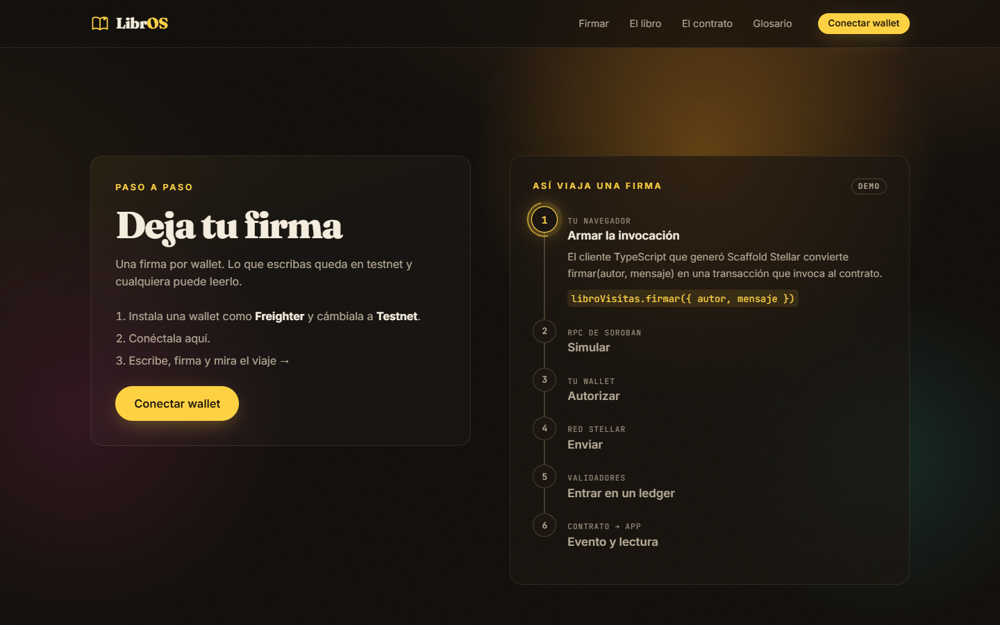
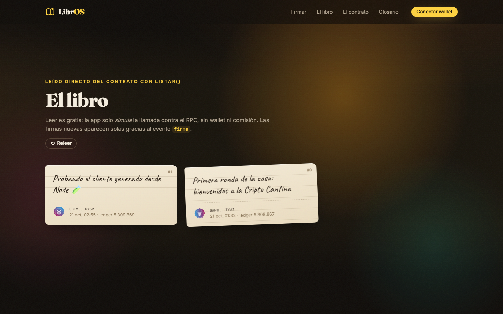
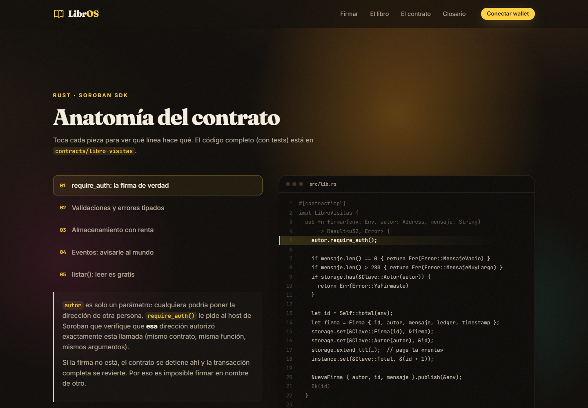

# LibrOS · El libro de visitas de la Cripto Cantina

> Challenge #1 · Stellar Sessions

Una dApp en Stellar donde cualquiera conecta su wallet, deja **un mensaje firmado on-chain** y la página muestra todas las firmas. También sirve para aprender: cuando firmas, la página te enseña en vivo cada fase de la transacción (armar, simular, autorizar, enviar, ledger y evento), y tiene una sección interactiva que explica el contrato línea por línea.


| Así viaja una firma | El libro | Anatomía del contrato |
|---|---|---|
|  |  |  |

## Contrato desplegado (testnet)

| | |
|---|---|
| **Contract ID** | `CASLUPVPQOKBZFWRZLOTPSE5SY56E5JS7YFW2XL7ZKIN7NFLFD2ZDOBQ` |
| Explorador | [Stellar Expert](https://stellar.expert/explorer/testnet/contract/CASLUPVPQOKBZFWRZLOTPSE5SY56E5JS7YFW2XL7ZKIN7NFLFD2ZDOBQ) · [Stellar Lab](https://lab.stellar.org/r/testnet/contract/CASLUPVPQOKBZFWRZLOTPSE5SY56E5JS7YFW2XL7ZKIN7NFLFD2ZDOBQ) |
| Tx de despliegue | [`236633…9984`](https://stellar.expert/explorer/testnet/tx/236633551c387a75e2709e20a1e683d41734365c9fe7947ebd4cf3a053179984) |

## Qué cumple

- [x] Proyecto creado con **Scaffold Stellar** (`stellar scaffold init`, plantilla React)
- [x] Contrato propio [`contracts/libro-visitas`](contracts/libro-visitas/src/lib.rs) con `firmar(autor, mensaje)` y `listar()`, usando `require_auth`
- [x] Frontend con el **cliente TypeScript generado** (`@stellar-scaffold/app-lib/clients`) y conexión de wallet (Stellar Wallets Kit)
- [x] Desplegado en **testnet**
- [x] README con contract ID, cómo correrlo y captura

**Puntos extra**

- [x] **Una firma por dirección**: el contrato devuelve `Error::YaFirmaste` si repites
- [x] **Eventos**: cada firma publica `NuevaFirma` (tema `"firma"`) y el frontend se suscribe para actualizar el libro en vivo
- [x] **Tests**: 8 tests unitarios (auth, una firma por wallet, validaciones, eventos, paginación)
- [x] **Algo creativo**: un diagrama que sigue tu transacción real paso a paso, una anatomía interactiva del contrato, sellos de cera generados a partir de cada dirección y un glosario

## El contrato

```rust
pub fn firmar(env: Env, autor: Address, mensaje: String) -> Result<u32, Error>
pub fn listar(env: Env) -> Vec<Firma>
pub fn listar_pagina(env: Env, desde: u32, limite: u32) -> Vec<Firma>
pub fn total(env: Env) -> u32
pub fn firma_de(env: Env, autor: Address) -> Option<Firma>
```

- `autor.require_auth()`: solo la wallet dueña de `autor` puede firmar en su nombre.
- Validación: el mensaje no puede estar vacío ni pasar de 280 bytes (`MensajeVacio`, `MensajeMuyLargo`).
- Storage: el contador `Total` vive en *instance* y cada `Firma { id, autor, mensaje, ledger, timestamp }` en *persistent*. El TTL se extiende para que las entradas no se archiven.
- Evento `NuevaFirma { autor, id, mensaje }` en cada firma.

## Cómo correrlo

Requisitos: [Rust](https://rustup.rs) con el target `wasm32v1-none`, [Stellar CLI](https://developers.stellar.org/docs/tools/developer-tools/cli/install-cli), [Scaffold Stellar CLI](https://github.com/stellar-scaffold/cli) (≥ 0.0.30), Node 22+ y una wallet como [Freighter](https://freighter.app) configurada en **Testnet**.

```bash
git clone https://github.com/Eco-RV/LibrOS.git
cd LibrOS
npm install

# Genera el cliente TypeScript apuntando al contrato desplegado en testnet
STELLAR_NETWORK=testnet stellar scaffold build

# Levanta el frontend
STELLAR_NETWORK=testnet npm start
```

En PowerShell: `$env:STELLAR_NETWORK="testnet"` antes de esos comandos. `app/.env.example` ya trae `STELLAR_NETWORK=testnet`; cópialo a `app/.env`.

<details>
<summary>Alternativa: generar el cliente solo con la Stellar CLI</summary>

Si tu `stellar scaffold` es anterior a 0.0.30 (no entiende el <code>scaffold.yml</code> v2), puedes generar el mismo cliente con el generador de bindings de la Stellar CLI:

```bash
stellar contract bindings typescript --network testnet \n  --contract-id CASLUPVPQOKBZFWRZLOTPSE5SY56E5JS7YFW2XL7ZKIN7NFLFD2ZDOBQ \n  --output-dir app-lib/clients/libro-visitas --overwrite
npm install
(cd app-lib/clients/libro-visitas && npx tsc)
```

Y crea `app-lib/clients/index.ts` con:

```ts
import { Client as LibroVisitas } from "./libro-visitas/dist/index.js"

export const options = {
	networkPassphrase: "Test SDF Network ; September 2015",
	rpcUrl: "https://soroban-testnet.stellar.org",
	allowHttp: false,
	publicKey: undefined,
}

export const libroVisitas = new LibroVisitas({
	...options,
	contractId: "CASLUPVPQOKBZFWRZLOTPSE5SY56E5JS7YFW2XL7ZKIN7NFLFD2ZDOBQ",
})
```

Luego `npx vite app` levanta solo el frontend.
</details>

Abre http://localhost:5173, conecta tu wallet (si tu cuenta no tiene XLM de prueba, la app te ofrece pedirlo a Friendbot) y firma.

### Tests del contrato

```bash
cargo test -p libro-visitas
```

### Desarrollo local (opcional)

Con Docker puedes usar la red `local`: `npm start` compila, despliega el contrato en un quickstart local y regenera el cliente con cada cambio en `contracts/`.

### Desplegar tu propia copia en testnet

```bash
stellar contract build --package libro-visitas
stellar keys generate yo --network testnet --fund
stellar contract deploy --wasm target/wasm32v1-none/release/libro_visitas.wasm \
  --source yo --network testnet --alias libro-visitas
```

Después pon el nuevo ID en `scaffold.yml` → `contracts.libro-visitas.networks.testnet.source`.

## Estructura

```
contracts/libro-visitas/   Contrato Soroban (Rust) + tests
app/                       Frontend React + Vite
  src/components/          Hero, SignForm, Journey, Guestbook, ContractAnatomy…
  src/hooks/useGuestbook   listar() + suscripción al evento "firma"
  src/lib/contract.ts      Cliente generado, errores en español, links al explorador
app-lib/                   Capa compartida de Scaffold (wallet, red, eventos)
scaffold.yml               Redes y contratos para Scaffold Stellar
```

## Licencia

Apache-2.0
